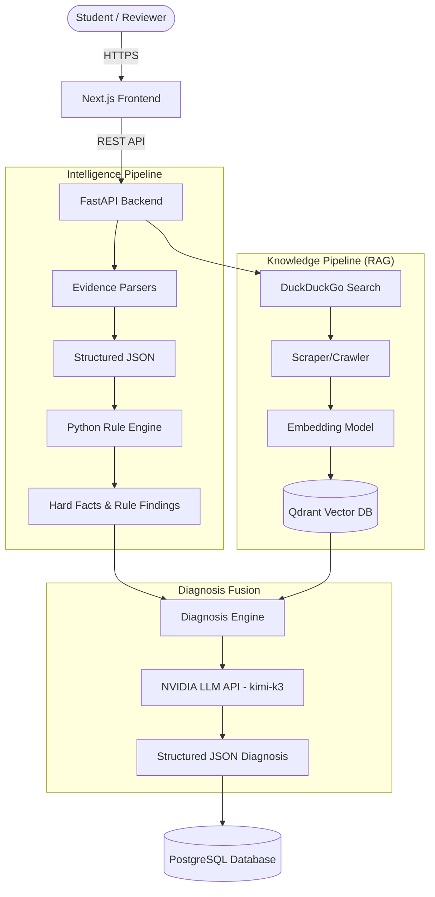

# NetSage System Architecture

## Architecture Diagram

## Layers of Architecture
1. **Frontend Layer**: Next.js App handling the student's interaction, evidence upload, and human review feedback.
2. **Orchestration Layer**: FastAPI directing requests, managing state, and triggering background jobs for RAG ingestion.
3. **Deterministic Layer**: TextFSM parsers converting Cisco CLI strings into JSON objects, and Python rules enforcing network laws (e.g., verifying subnets, VLAN mismatches).
4. **Knowledge Layer**: Qdrant vector database caching chunked, embedded knowledge scraped from Cisco's documentation.
5. **Reasoning Layer**: NVIDIA API receiving a composite prompt containing rules, parsed facts, and vector context to formulate a structured JSON diagnosis.
6. **Persistence Layer**: PostgreSQL tracking cases, evidence, diagnoses, and human reviews for future evaluations.
