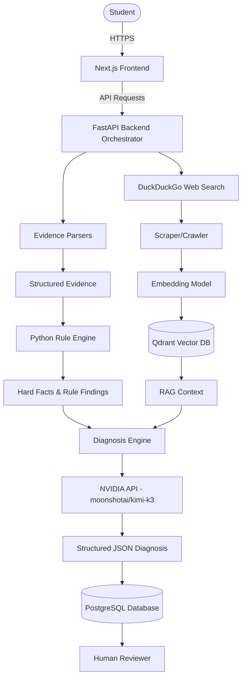

# NetSage AI — Implementation Documentation

## 1. System Objective
NetSage is a full-stack, AI-assisted network troubleshooting platform designed for students working with Cisco Packet Tracer. 

The system takes:
- Student-described symptoms
- Network topology graph (nodes, interfaces, subnets)
- Cisco `show` command outputs (evidence)

And produces:
1. Likely root cause & OSI layer
2. Confidence score
3. Evidence supporting the diagnosis
4. Deterministic rule violations (via Python Rule Engine)
5. Next best diagnostic command
6. Recommended fix
7. Human-review status

## 2. High-Level Architecture
NetSage employs a multi-agent structure where the AI reasons over explicitly parsed facts and rules, rather than raw strings.

---

## 3. Technology Stack Roadmap

### 3.1. Frontend
- **Framework**: React / Vite (Currently prototyped in `App.tsx`) -> Transitioning to **Next.js** for routing and dashboard management.
- **UI Libraries**: Tailwind CSS, shadcn/ui.
- **State Management**: TanStack Query for API interactions.
- **Core Views to Implement**:
  - Dashboard (Active cases, resolved cases)
  - Case Creation Form (Symptom & Topology input)
  - Evidence Editor (Parsing and displaying command outputs)
  - Diagnosis View (LLM results + human review feedback)

### 3.2. Backend (FastAPI Core)
- **Framework**: FastAPI + Python.
- **Database (Relational)**: PostgreSQL (Users, Cases, Evidence, Parsed Evidence, Diagnostics, Reviews).
- **Background Jobs**: Celery + Redis (for handling slow web scraping, parsing, and LLM inference).
- **Core APIs**:
  - `POST /api/v1/cases`
  - `POST /api/v1/cases/{id}/evidence`
  - `POST /api/v1/cases/{id}/diagnosis`

### 3.3. RAG Pipeline (Qdrant + DuckDuckGo)
To ensure the LLM has up-to-date networking context and Cisco documentation:
- **Search Tool**: DuckDuckGo API/Scraper to fetch Cisco configuration guides and troubleshooting documentation on the fly if it's missing from the knowledge base.
- **Vector Database**: **Qdrant** (replacing pgvector for advanced hybrid search and scaling).
- **Embeddings**: Local embedding models or remote APIs.
- **Pipeline**:
  1. Fetch source via DuckDuckGo.
  2. Scrape and clean HTML (BeautifulSoup / Trafilatura).
  3. Semantic Chunking (split by headers/sections).
  4. Embed and store in Qdrant with rich metadata (Topic, Command, Device Type).

### 3.4. The Intelligence Layer
#### A. Python Rule Engine
Before hitting the LLM, deterministic facts are calculated. 
- Example rules to write in Python:
  - `NET-001`: Gateway is outside subnet.
  - `NET-002`: Interface is administratively down.
  - `NET-003`: Duplicate IP detected.
  - `NET-004`: VLAN missing on trunk.

#### B. Evidence Parsers
Regex/TextFSM templates to convert raw CLI strings into structured JSON.
- `show ip interface brief` -> interface status dicts.
- `show vlan brief` -> active VLANs and assigned ports.
- `show ip route` -> routing table mapping.

#### C. LLM Reasoning (NVIDIA API)
The LLM does NOT parse raw strings. The context window is built by combining:
1. Symptoms & Topology
2. Structured Evidence (from parsers)
3. Hard Facts (from Rule Engine)
4. RAG context (from Qdrant)

---

## 4. Phased Implementation Plan

### Phase 1: Foundation (Current Goal)
- Scaffold the Next.js frontend (migrating components out of the monolithic `App.tsx`).
- Setup FastAPI basic routes and PostgreSQL schema (Cases, Users, Evidence).

### Phase 2: Parsers & Rule Engine
- Build the parsing engine for the top 5 commands:
  - `show ip interface brief`, `show vlan brief`, `show ip route`, `show access-lists`, `show interfaces trunk`.
- Build the Python rule engine to evaluate structured evidence (e.g., checking if a ping destination is in the routing table).

### Phase 3: RAG & Qdrant Integration
- Setup Qdrant Docker container.
- Build the DuckDuckGo search and ingest pipeline to scrape Cisco docs.
- Create semantic chunking logic and store embeddings in Qdrant.

### Phase 4: Local LLM Orchestration
- Connect FastAPI to the local Ollama instance.
- Design the Context Builder that fuses Rule Findings + Qdrant RAG + User Evidence.
- Enforce structured JSON output from the LLM for reliable frontend rendering.

### Phase 5: Verification & Review
- Build the Human Review UI (Accept, Edit, Reject).
- Setup the evaluation pipeline to track AI accuracy versus actual network resolution in Packet Tracer.
